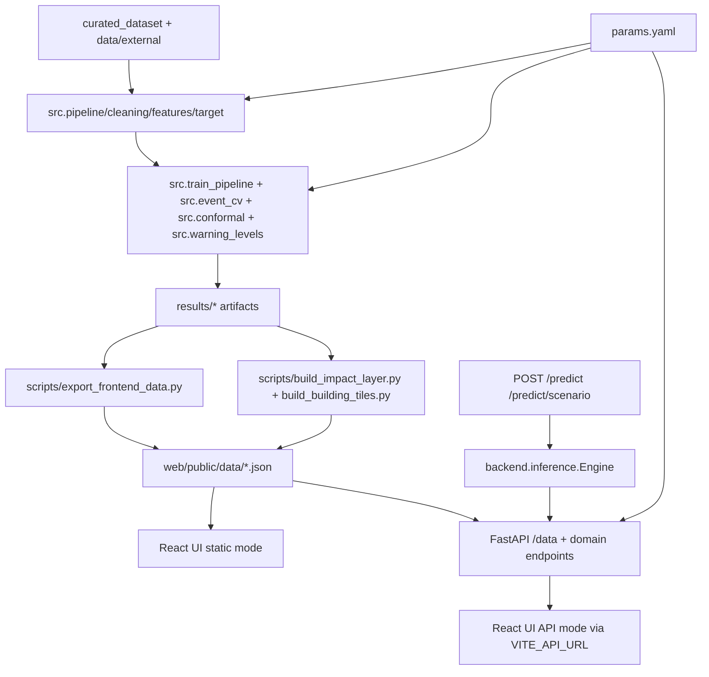

# PROJECT_CONTEXT_REPORT

## Report metadata
- **Repository:** `harsh-d58/Flash_Flood_Prediction`
- **Default branch (task context):** `main`
- **Current local branch inspected:** `copilot/create-documents-technical-handover`
- **Report date:** 2026-10-27
- **Evidence scope:** Source files, configs, docs, scripts, tests, and tracked artifacts under this clone. No live deployment probing, no full pipeline/test execution in this run.

---

## 1) Project overview
**Project name:** PRAHAR (Uttarakhand Flash-Flood Intelligence) (`README.md`, `docs/architecture.md`).

**Purpose/problem:** Research/decision-support prototype for flash-flood nowcasting and exposure context in Uttarakhand using multimodal hydro-meteorological and historical data (`README.md`, `src/*`, `scripts/run_all.py`).

**Target users (implied by UI + docs):** Analysts/operations teams reviewing district/station risk, uncertainty, and impact overlays (`web/src/pages/*`, `docs/ops/runbook.md`).

**Important safety framing (explicit):** This is **not** an evacuation/damage decision engine; it is a decision-support prototype (`README.md` “What this is not”, `docs/licences.md`, landing footer `web/src/pages/Landing.tsx`).

**Current state:**
- End-to-end research pipeline exists and is scripted (`scripts/run_all.py`, 28 staged tasks).
- Deployed inference path uses **XGBoost + Exp_G_Static_History (23 features)** (`src/data_loader.py`, `backend/inference.py`, `models/xgboost/metadata.json`).
- Frontend supports dual mode: static exported JSON and FastAPI-backed API mode (`web/src/lib/data.ts`, `backend/app.py`).
- Operational DB and full auth/RBAC are not implemented despite future ADR planning (`docs/adr/README.md`).

---

## 2) Complete technology stack (actual, file-derived)

### Backend / ML / pipeline
- **Language/runtime:** Python 3.12 (Render env declares `PYTHON_VERSION=3.12.7`) (`render.yaml`).
- **API framework:** FastAPI `0.135.1`, Uvicorn `0.41.0`, Pydantic `2.12.5` (`requirements.txt`, `backend/app.py`).
- **Data/ML libs:** pandas `2.3.1`, numpy `2.3.2`, pyarrow `25.0.1`, scikit-learn `1.7.1`, xgboost `3.2.0`, shap `0.51.0`, joblib `1.5.1` (`requirements.txt`).
- **Inference architecture:** startup-loaded model/cache, O(1) online rainfall feature updates, Venn-Abers calibration, Mondrian conformal sets (`backend/inference.py`, `src/online_features.py`, `src/conformal.py`, `src/warning_levels.py`).

### Frontend
- **Framework:** React `19.2.8` + React DOM `19.2.8` (`web/package.json`).
- **Routing:** React Router DOM `7.18.4` (`web/package.json`, `web/src/main.tsx`).
- **Map/charting:** MapLibre GL `6.13.0`, Recharts `3.10.1` (`web/package.json`).
- **Build tooling:** Vite `8.3.0`, TypeScript `~6.0.2`, Tailwind `4.3.3` (`web/package.json`, `web/vite.config.ts`).
- **Linting:** Oxlint `1.81.0` (`web/package.json`, CI workflow).

### Testing / QA
- **Test runner:** pytest `9.0.3` (`requirements.txt`, `.github/workflows/ci.yml`).
- **CI:** GitHub Actions runs Python tests + web build/lint (`.github/workflows/ci.yml`).
- **Lineage/integrity checks:** `scripts/audit_pipeline.py`, raw manifest checks in tests (`tests/test_data.py`).

### Deployment / hosting evidence
- **API:** Render configuration present (`render.yaml`).
- **Web:** Vercel configuration and runbook instructions (`web/vercel.json`, `docs/ops/runbook.md`).
- **Status:** Config/docs evidence only; live deployment not verified in this run.

### Database / ORM / migrations
- **Current implementation:** No operational DB stack found (no SQLAlchemy/Alembic/migrations/schema SQL files in repo tree scan).
- **Planned only:** ADR-011 entry in `docs/adr/README.md` marks PostgreSQL + PostGIS + TimescaleDB as **proposed (v1.0)**, not implemented.

### Auth/security model (current)
- No user login/registration/session/JWT role system in current app code.
- Security controls implemented are API-surface controls: CORS allow-list + admin token gate for reload route (`backend/app.py`, `params.yaml`, `tests/test_api.py`).

---

## 3) Project structure (annotated, compact)

```text
Flash_Flood_Prediction/
├─ backend/
│  ├─ app.py                      # FastAPI routes, middleware, CORS, ETag, admin reload token
│  └─ inference.py                # Startup inference engine, model load, calibration/conformal, O(1) updates
├─ src/                           # Data prep, feature engineering, training, calibration, tiers, verification
│  ├─ cleaning.py                 # QC logic and cleaned parquet outputs
│  ├─ target.py                   # flood_event_24h target construction and label availability handling
│  ├─ data_loader.py              # Experiment feature sets; FINAL_EXPERIMENT=Exp_G_Static_History
│  ├─ train_pipeline.py           # Model training/evaluation/report artifact generation
│  ├─ online_features.py          # StationState incremental feature algorithm
│  └─ warning_levels.py           # Hybrid tier assignment (ML + rainfall rule)
├─ scripts/
│  ├─ run_all.py                  # 28-stage orchestration from data to audit
│  ├─ export_frontend_data.py     # Builds web/public/data/*.json from artifacts
│  ├─ check_apis.py               # Generates system.json with external/local service checks
│  ├─ build_impact_layer.py       # Exposure layer generation
│  └─ build_building_tiles.py     # Per-tile impact GeoJSON generation
├─ web/
│  ├─ src/main.tsx                # React entrypoint and route map
│  ├─ src/lib/data.ts             # Static vs API data source switching via VITE_API_URL
│  ├─ src/pages/*                 # Landing + app pages (overview/forecast/map/impact/etc.)
│  ├─ package.json                # Frontend deps/scripts
│  ├─ vite.config.ts              # /api proxy to backend in dev API mode
│  └─ vercel.json                 # SPA rewrite/build config
├─ tests/                         # Data contracts, API/security, online-feature parity, terrain, model behaviour
├─ docs/
│  ├─ architecture.md             # As-built architecture summary
│  ├─ metrics.md                  # Metric definitions and strict vs lenient interpretations
│  ├─ ops/runbook.md              # Ops commands/deploy runbook
│  └─ adr/README.md               # ADR index incl. proposed ADR-011 DB decision
├─ curated_dataset/               # Curated source CSVs + MANIFEST.sha256
├─ data/processed/                # Pipeline outputs (parquet/csv)
├─ models/                        # Saved model artifacts + metadata
├─ results/                       # Metrics, calibration, verification, robustness, reports
├─ params.yaml                    # Central model/QC/tier/impact/API constants
├─ requirements.txt               # Python dependency pins
└─ render.yaml                    # Render API deploy config
```

Notes:
- Large generated map tiles and result artifacts are intentionally not exhaustively listed here.

---

## 4) Architecture and data flow

### Startup and runtime behavior
- `backend/app.py` loads JSON blobs + `Engine()` at startup via lifespan hook.
- `Engine` loads model + station history/cache + calibration artifacts once (`backend/inference.py`), avoiding per-request disk I/O.
- Frontend reads either static files (`/data/*.json`) or API (`/api/...` proxy) depending on `VITE_API_URL` (`web/src/lib/data.ts`, `web/.env.api`, `web/vite.config.ts`).

### Mermaid (as observed)


### Key architectural reconciliations
1. **Static JSON vs API mode:** Both are implemented. Static mode serves pre-exported files; API mode serves equivalent datasets and live prediction endpoints (`web/src/lib/data.ts`, `backend/app.py`).
2. **Deployed model feature count:** Runtime engine uses `FINAL_EXPERIMENT = Exp_G_Static_History` with 23 features (`src/data_loader.py`, `backend/inference.py`, `models/xgboost/metadata.json`).
3. **DB ADR mismatch:** ADR-011 exists only as proposed; no DB implementation is present in current codebase (`docs/adr/README.md`, repo scan).

---

## 5) Complete feature inventory (status-classified)

### Implemented and verified (code + direct tests/docs evidence)
1. **FastAPI health/data API + ETag/caching/gzip**
   - Files: `backend/app.py`, `tests/test_api.py`
2. **Live prediction API with calibrated probability + conformal/tier outputs**
   - Files: `backend/app.py` (`/predict`, `/predict/scenario`), `backend/inference.py`
3. **O(1) online rainfall feature updates**
   - Files: `src/online_features.py`, parity test `tests/test_online_features.py`
4. **Hybrid warning tier logic (ML + rainfall rule)**
   - Files: `src/warning_levels.py`, artifacts in `results/warning_levels/*`
5. **End-to-end orchestrated pipeline**
   - File: `scripts/run_all.py` stage list
6. **Frontend multipage console + route structure**
   - File: `web/src/main.tsx` and page files
7. **Data integrity checks (manifest, label/range contracts, terrain unit tests)**
   - Files: `tests/test_data.py`, `tests/test_labels.py`, `tests/test_terrain.py`
8. **CI pipeline for tests and web build/lint**
   - File: `.github/workflows/ci.yml`

### Implemented but unverified in this run (not executed now)
1. **Command-level success claims in docs (e.g., 51 tests passing, latency targets)**
2. **External service health checks pipeline (`/health/external`, `scripts/check_apis.py`)**
3. **Full 28-stage rebuild correctness on this machine**
4. **Render/Vercel deployed instances availability**

### Partially implemented
1. **Event replay detail module in UI** shows explicit “Pending module” placeholder
   - Files: `web/src/pages/Secondary.tsx`, `web/src/components/ui.tsx`
2. **RiskMap layers “extent” and “depth” marked “soon” (disabled)**
   - File: `web/src/pages/RiskMap.tsx`
3. **Some source statuses intentionally marked pending (e.g., satellite precipitation, DEM in deployed model)**
   - File: `scripts/export_frontend_data.py`

### Planned
1. **Operational DB stack (PostgreSQL + PostGIS + TimescaleDB)**
   - File: `docs/adr/README.md` (ADR-011 proposed)
2. **Additional v1.0 architecture/security/workstream items**
   - File: `PRAHAR_MASTER_PLAN.md` (planning document; not implementation proof)

### Broken / known fragile behavior (evidence-backed)
1. **Historical drift between docs/plans and current implementation can mislead maintainers** (e.g., roadmap docs mention future auth/DB not in code).
2. **No direct evidence of core feature runtime breakage in inspected code/tests; no failing execution logs collected in this run.**

---

## 6) Frontend routes/pages and backend API endpoints

### Frontend routes (React Router)
| Route | Component | Notes |
|---|---|---|
| `/` | `Landing` | Marketing/explainer with disclaimer (`web/src/pages/Landing.tsx`) |
| `/app` | `AppShell` | Redirects to `overview` |
| `/app/overview` | `Overview` | Situation summary |
| `/app/forecast` | `Forecast` | Timeline/lead-time view |
| `/app/map` | `RiskMap` | Layered map view |
| `/app/impact` | `Impact` | Exposure/building/asset view |
| `/app/uncertainty` | `Uncertainty` | Calibration/coverage/robustness |
| `/app/events` | `Events` | Event list + pending replay module |
| `/app/model` | `Model` | Provenance/model cards |
| `/app/metrics` | `Metrics` | Validation/external metrics |
| `/app/system` | `System` | Service checks/latency/notebook status |
| `/app/space` | redirect | Redirects to `/app/overview` |

Source: `web/src/main.tsx`.

### Backend endpoints (FastAPI)
| Method | Path | Input | Output | Errors | Auth/Security |
|---|---|---|---|---|---|
| GET | `/health` | none | startup/model/data status | - | open |
| GET | `/health/external` | none | probe summary for third-party services | probe errors embedded | open |
| GET | `/data/{name}` | path `name` | JSON/GeoJSON blob | 404 if missing export | ETag/304 |
| GET | `/stations` | - | station list | - | ETag/304 |
| GET | `/risk/snapshot` | - | snapshot data | - | ETag/304 |
| GET | `/risk/timeline` | - | timeline data | - | ETag/304 |
| GET | `/model/summary` | - | model summary | - | ETag/304 |
| GET | `/metrics` | - | metrics payload | - | ETag/304 |
| GET | `/events` | - | events payload | - | ETag/304 |
| GET | `/impact/summary` | - | impact payload | - | ETag/304 |
| GET | `/impact/tiles/index` | - | tiles index | 404 if tiles missing | ETag/304 |
| GET | `/impact/tiles/{z}/{x}/{y}` | z/x/y ints | GeoJSON tile | empty FC for missing tile | cache-control max-age |
| GET | `/landmarks` | - | landmarks geojson | - | ETag/304 |
| POST | `/predict` | `{station, readings[], overrides?}`; `rain_mm` validated `0..MAX_PLAUSIBLE_MM_HR` | calibrated score, conformal/tier fields, latency | 404 unknown/quarantined station | open |
| POST | `/predict/scenario` | same model without state mutation | scenario scoring subset | 404 unknown station | open |
| POST | `/admin/reload` | header `X-Admin-Token` | reload confirmation | 403 token env not set; 401 wrong/missing token | token-gated route |

Source: `backend/app.py`, `tests/test_api.py`.

---

## 7) Database & data models

## 7.1 Operational DB status
- **Confirmed absent:** no DB server config, ORM models, migration system, schema files, or SQL migration artifacts in repository scan.
- **Implication:** Data persistence relies on files/artifacts (CSV/Parquet/JSON/model files), not transactional DB-backed operations.

## 7.2 Data model patterns (file-based)
- **Core training table:** `data/processed/final/uttarakhand_flash_flood_ml_dataset.parquet` (used by pipeline/export/inference preload).
- **Target label model:** `flood_event_24h` with post-coverage rows set to NaN (`src/target.py`).
- **Prediction artifacts:** warning-level CSV/JSON outputs under `results/warning_levels/` used by export and UI.
- **Frontend contracts:** typed TS interfaces in `web/src/lib/data.ts` for snapshot/timeline/model/metrics/events/system/impact payloads.

No relational schema/keys/indexes can be documented because no operational DB schema exists in current code.

---

## 8) Authentication & security

### Implemented controls
- **CORS allow-list + regex:** from `params.yaml` or `PRAHAR_CORS_ORIGINS`; regex allows `*.vercel.app` (`backend/app.py`, `params.yaml`).
- **Admin route token protection:** `/admin/reload` requires env `PRAHAR_ADMIN_TOKEN` and header `X-Admin-Token`; constant-time compare (`backend/app.py`).
- **Input validation:** Pydantic models enforce payload shape and rain cap (`backend/app.py`).
- **Response hardening/perf:** gzip middleware, ETag behavior, controlled cache headers (`backend/app.py`).

### Missing security capabilities (current)
- No user auth (login/register/JWT/session), no RBAC/permissions matrix, no per-client rate limiting, no audit logging subsystem for user actions.

### Security risks
- `/predict` and most data endpoints are publicly callable by design.
- External URL probing endpoint can be operationally noisy if abused (`/health/external`), though timeout/caching exist.

---

## 9) UI/UX design system and accessibility risks

### Current UI system
- Tailwind-driven glassmorphism + dark palette, branded PRAHAR visuals, map-centric interaction (`web/src/index.css`, page/components).
- Reusable UI primitives: `Panel`, `Stat`, `TierBadge`, `Bar`, `Pending`, `PageHead` (`web/src/components/ui.tsx`).
- Route transition and loading overlays via custom animated river components (`web/src/components/RiverLoader.tsx`).

### UX strengths
- Clear route taxonomy (Situation/Analysis/Validation/Platform in `AppShell`).
- Direct surfacing of confidence/conformal context and source health.
- Explicit prototype disclaimer in landing/footer.

### Accessibility risks (code-level observations)
- Heavy map/canvas and animation usage may challenge reduced-motion/low-power users.
- Color-heavy status communication (tiers/alerts) may need stronger non-color redundancy in all contexts.
- Some imagery has decorative alt text patterns (`alt=""`) appropriate for decoration, but key informational images/graphs should be periodically audited for SR usability.

---

## 10) Setup & execution guide (verified vs inferred)

### Verified from repository files
- Python deps install: `pip install -r requirements.txt` (`README.md`, `docs/ops/runbook.md`).
- Full pipeline: `python scripts/run_all.py` (`README.md`, `scripts/run_all.py`).
- Resume export onward: `python scripts/run_all.py --from export` (`README.md`, `scripts/run_all.py`).
- API server: `python -m uvicorn backend.app:app --port 8000` (`README.md`, runbook).
- Web static dev: `cd web && npm install && npm run dev` (`README.md`, `web/package.json`).
- Web API dev mode: `cd web && npm run dev:api` with `VITE_API_URL=/api` (`web/.env.api`, `web/package.json`, `web/vite.config.ts`).
- Tests: `python -m pytest -q -m "not network" tests` (`README.md`, CI workflow).
- Web build/lint: `npm run build`, `npx oxlint src` in `web/` (CI workflow).

### Environment variable names (no values)
- `PRAHAR_CORS_ORIGINS`
- `PRAHAR_ADMIN_TOKEN`
- `VITE_API_URL`

### Deployment (inferred-from-config/documented, not runtime-verified)
- API deploy on Render via `render.yaml`.
- Web deploy on Vercel via `web/vercel.json` + runbook instructions.

### Common troubleshooting (documented)
- Metrics blank in API mode -> re-export and admin reload (`docs/ops/runbook.md`).
- Raw manifest mismatch -> regenerate/justify (`docs/ops/runbook.md`, `tests/test_data.py`).

---

## 11) Current issues & technical debt (severity/evidence/impact/fix)

| Severity | Issue | Evidence | Affected files | Impact | Recommended fix |
|---|---|---|---|---|---|
| P0 | No operational auth/RBAC beyond admin token gate | No login/session/JWT flows in backend/frontend; only `PRAHAR_ADMIN_TOKEN` gate for reload | `backend/app.py`, repo scan | Public endpoints may be acceptable for demo, but operational hardening incomplete | Add formal API auth (keys/JWT), role boundaries, rate limits, abuse monitoring |
| P1 | Planned DB architecture not implemented | ADR-011 marked proposed; no ORM/migrations/schema files found | `docs/adr/README.md`, repo scan | Limits multi-user operational state/history/queryability | Implement minimal persistent store and migration baseline before operational rollout |
| P1 | Placeholder modules in production UI routes | “Pending module” and disabled map layers (`extent`, `depth`) | `web/src/pages/Secondary.tsx`, `web/src/pages/RiskMap.tsx`, `web/src/components/ui.tsx` | User sees unfinished capabilities in active nav | Hide behind feature flags or complete implementation |
| P1 | Documentation drift risk between roadmap docs and as-built code | Extensive future-state plans in master docs vs current file-based stack | `PRAHAR_MASTER_PLAN.md`, codebase | New contributors may assume non-existent services are live | Maintain a strict “as-built status” doc synced per release |
| P2 | Accessibility/performance risk from heavy animation and visual density | Route transition + loading overlays + rich map layers | `web/src/components/RiverLoader.tsx`, map pages | Potential usability issues on low-spec or assistive contexts | Add reduced-motion mode and simplify fallback UI paths |
| P2 | Potential model-behaviour caveat retained (documented xfail) | Monotonicity test marked strict xfail | `tests/test_model_behaviour.py` | Known edge behavior may reduce trust in rare scenarios | Continue monotone study and re-test with expanded labels/data |

---

## 12) Important files & workflow traces

### Critical workflow trace A: Data-to-UI artifact path
1. Pipeline and model artifacts built (`scripts/run_all.py`, `src/*`, `results/*`).
2. `scripts/export_frontend_data.py` composes runtime JSON contracts from those artifacts.
3. JSON written to `web/public/data/*.json`.
4. Frontend consumes via `useData(...)` in static mode (`web/src/lib/data.ts`) or API passthrough mode (`backend/app.py` endpoints).

### Critical workflow trace B: Live prediction path
1. API starts and loads `Engine()` once (`backend/app.py` lifespan).
2. `Engine` loads model/cache/calibration (`backend/inference.py`).
3. `/predict` validates payload (`Reading`, `PredictIn`), updates station state O(1), scores model, calibrates/conformalizes, assigns tier.
4. Response returns scored outputs + latency.

### Selected high-leverage files
- `backend/app.py` — authoritative API contract and middleware/security behavior.
- `backend/inference.py` — runtime scoring engine and calibration logic.
- `src/data_loader.py` — feature experiment definitions and deployed experiment selector.
- `src/online_features.py` — incremental feature math.
- `src/warning_levels.py` — hybrid tier policy.
- `scripts/run_all.py` — executable DAG order.
- `scripts/export_frontend_data.py` — static/API data contract source.
- `web/src/main.tsx` and `web/src/lib/data.ts` — route/data wiring.
- `tests/test_api.py`, `tests/test_data.py`, `tests/test_online_features.py` — behavioral and contract guards.

---

## 13) Testing & deployment status

### Testing inventory (from files)
- Python tests in `tests/` cover API, data contracts, labels, online feature parity, terrain, model behaviour.
- CI runs `pytest -m "not network"` and web build/lint (`.github/workflows/ci.yml`).

### Verified vs not verified in this reporting run
- **Verified:** test/config presence, test scope, CI definitions, command references.
- **Not verified here:** actual pass/fail execution of tests/builds, runtime latency measurements, live deployment health.
- README claims (e.g., “51 tests”, headline metrics) are documented evidence but not re-executed in this session.

---

## 14) Recommended roadmap (prioritized)

### P0 (critical)
1. Introduce operational API authentication/rate limiting for non-demo deployments.
2. Define and enforce production security baseline (access control, endpoint protection, monitoring).

### P1 (essential)
1. Implement first operational persistence layer (starting from ADR-011 intent) with migration baseline.
2. Resolve visible “pending/soon” modules (event replay detail, flood extent/depth layers) or hide behind release flags.
3. Add explicit as-built vs planned status matrix to prevent architecture drift confusion.

### P2 (quality)
1. Accessibility pass (reduced motion, keyboard path audits, contrast/non-color encoding checks).
2. Strengthen observability around API usage and error classes.
3. Expand validation coverage beyond single-month holdout with reproducible release criteria.

### P3 (advanced)
1. Advance planned geospatial-serving optimizations (e.g., PMTiles path from ADR list).
2. Operationalize broader multimodal inputs once ingestion/label confidence is mature.

Dependency order: P0 security controls should precede public/operational scaling; persistence foundation should precede advanced multi-user operational features.

---

## CHATGPT PROJECT CONTEXT

PRAHAR in this repository is a **Uttarakhand flash-flood decision-support prototype** with a Python ML pipeline, FastAPI backend, and React/MapLibre frontend. The implemented runtime stack is file/artifact-driven (CSV/Parquet/JSON/model artifacts), not DB-backed. Pipeline orchestration is centralized in `scripts/run_all.py` (28 stages), and frontend runtime data is generated by `scripts/export_frontend_data.py` into `web/public/data`.

The deployed inference path uses **XGBoost with `Exp_G_Static_History` (23 features)** (`src/data_loader.py`, `models/xgboost/metadata.json`, `backend/inference.py`). Online inference updates rainfall features in O(1) using `src/online_features.py`, then applies Venn-Abers calibration and Mondrian conformal outputs, followed by hybrid tiering in `src/warning_levels.py`.

Frontend routes are defined in `web/src/main.tsx`: landing `/`, and app views under `/app/*` for overview, forecast, map, impact, uncertainty, events, model, metrics, and system. `/app/space` redirects to overview. Data access is dual-mode in `web/src/lib/data.ts`: static JSON mode by default, or API mode when `VITE_API_URL` is set (typically `/api` with Vite proxy). Backend endpoints in `backend/app.py` include health/data endpoints, impact tile endpoints, and POST `/predict`, `/predict/scenario`, and `/admin/reload`.

Security currently includes CORS allow-list controls and admin token protection for reload (`PRAHAR_CORS_ORIGINS`, `PRAHAR_ADMIN_TOKEN`, `X-Admin-Token`), plus Pydantic input validation and middleware-level performance/caching behaviors. There is **no implemented user auth system** (no login/register/session/JWT/RBAC flows).

Database status: **no operational database, ORM, migrations, or schema files are present** in current implementation. ADR index (`docs/adr/README.md`) lists PostgreSQL + PostGIS + TimescaleDB as **proposed** (ADR-011), not implemented.

Known implementation status highlights:
- Implemented core: pipeline, model training/evaluation artifacts, API serving, static/API frontend modes, risk/impact visualization, tests and CI.
- Partial: some UI modules are explicitly pending/disabled (event replay detail module and flood extent/depth map layers).
- Important caution: planning docs may describe future architecture; use code/config files as source of truth for current behavior.

Testing/deployment evidence:
- Tests and CI definitions are present (`tests/*`, `.github/workflows/ci.yml`), but this report did not execute them.
- Deployment config exists for Render API (`render.yaml`) and Vercel web (`web/vercel.json`, runbook docs); live health was not verified in this run.

Change-safety guidance for future edits:
1. Preserve parity between static-export JSON contracts and API responses.
2. Keep `FINAL_EXPERIMENT`/feature schema consistent across training, exported artifacts, and inference engine loads.
3. Treat all metric claims as definition-bound (`docs/metrics.md`) and avoid mixing strict vs lenient district-day interpretations.
4. Maintain explicit prototype disclaimer: this system supports analysis and preparedness, not evacuation/damage decision automation.

---

## Inspection limits / unknowns
- No live runtime execution was performed in this session, so pass/fail and latency figures are not independently re-verified.
- Remote deployment state (Render/Vercel availability, real-time data freshness) could not be confirmed from files alone.
